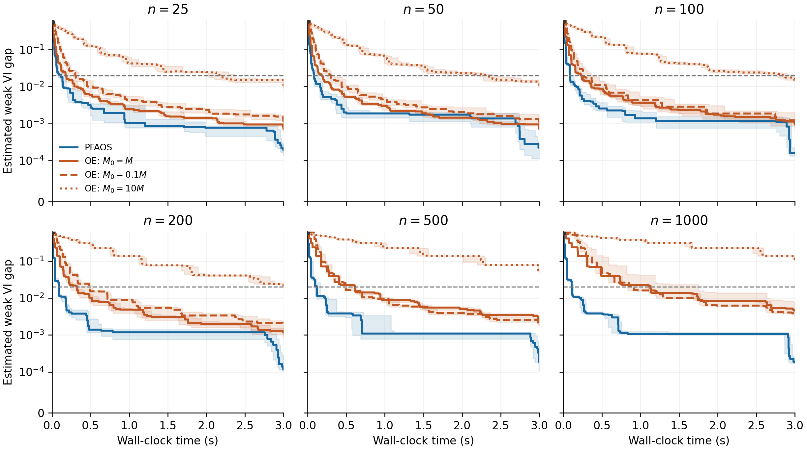
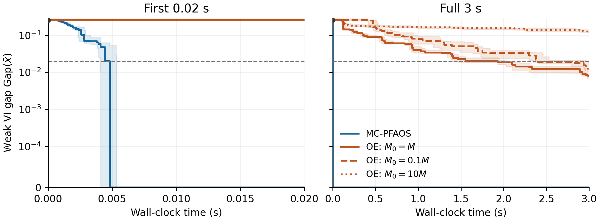

# CVI_IJOC: parameter-free methods for constrained variational inequalities

[](https://github.com/qluorocky/CVI_IJOC/actions/workflows/tests.yml)

Python implementations and numerical experiments for **PFAOS** and
**MC-PFAOS**, accompanying *Parameter-Free First-Order Method for Constrained
Variational Inequalities*. The experiments compare the proposed methods with
projected operator extrapolation (OE) on normalized bilinear games with convex
quadratic coupling constraints.

The repository includes the experiment drivers, pinned Python dependencies,
160 paired synthetic instances represented by seeds and generator code,
4,634 saved diagnostic checkpoints, Python plotting code, and LaTeX figures,
tables, and experiment description. All instance data are generated locally;
no external dataset or commercial solver is required.

## Install

Python **3.12** is the reference environment. From a terminal:

```bash
git clone https://github.com/qluorocky/CVI_IJOC.git
cd CVI_IJOC
python3.12 -m venv .venv
source .venv/bin/activate
python -m pip install -r requirements.txt
export OPENBLAS_NUM_THREADS=1 OMP_NUM_THREADS=1 MKL_NUM_THREADS=1
```

On Windows, activate with `.venv\Scripts\Activate.ps1` and set the three
thread variables to `1` in PowerShell before running Python. CVXPY and Clarabel
are installed by `requirements.txt`; no separate solver installation is needed.

## Quick check

```bash
python -m pytest -q
python run_pfaos.py --n 25 --seeds 1 --seconds 0.5 --iterations 100 --out results/smoke_pfaos
python run_mc_pfaos.py --fixed-n 25 --m 5 --n 25 --fixed-m 5 --seeds 1 --seconds 0.5 --iterations 100 --out results/smoke_mc
```

These small runs check both drivers and write their own checkpoint CSVs. They
do not reproduce the paper's full grids or guarantee attainment of the target.
Use a new output directory for each run. The main drivers refuse to overwrite
an existing configuration or append to an existing experiment CSV.

## Rebuild the released figures and tables

This uses the supplied checkpoints and does **not** rerun the algorithms:

```bash
python plot_results.py \
  --pfaos results/pfaos/checkpoints.csv \
  --mc results/mc/checkpoints.csv \
  --output results/reproduction_figures --target 0.02
```

The command generates four PDF/PNG figures, three LaTeX tables, and two
per-seed summary CSVs. The plotting layout expects the full supplied grids,
including `n=50, m=100` for the MC-PFAOS convergence plots.

## Rerun all experiments

```bash
python run_pfaos.py \
  --n 25,50,100,200,500,1000 --seeds 10 --seconds 3 \
  --target 0.02 --iterations 10000 --out results/reproduction_pfaos
python run_mc_pfaos.py \
  --fixed-n 50 --m 2,5,10,20,40,100,250,500 \
  --n 25,50,100 --fixed-m 5 --seeds 10 --seconds 3 \
  --target 0.02 --iterations 10000 --out results/reproduction_mc
python plot_results.py \
  --pfaos results/reproduction_pfaos/checkpoints.csv \
  --mc results/reproduction_mc/checkpoints.csv \
  --output results/reproduction_figures_new --target 0.02
```

There are 60 paired single-constraint instances and 100 paired
multi-constraint instances. Each method has a three-second algorithm budget
per instance. Offline weak-gap evaluation adds time, especially at `m=500`,
and is excluded from the reported algorithm times. The full run therefore
takes longer than the 16 minutes of nominal algorithm budgets. Measured
times and the last completed iterate can vary across machines.

The dimension and constraint-count studies are separate: the release tests
`n=1000, m=1` and `n=50, m=500`, without combining both maxima.

## What is measured

The target is `max(weak VI gap, ||[G(x_bar)]_+||_2) <= 0.02`, evaluated at
saved averaged iterates after both timed methods finish. Time to target is
the first **saved** checkpoint satisfying both criteria. Unsuccessful runs
are censored; reported target-time medians use successful runs only.

The reported OE baseline is `cvx_benchmark.py`. Every projection trial builds
a fresh CVXPY model and uses Clarabel with `1e-7` tolerances, without warm
starts or a parameterized compilation cache. All model and projection work
is timed. `projected_oe.py` retains the earlier Dykstra implementation for
regression tests; it is not the baseline in the released tables.

See [REPRODUCIBILITY.md](REPRODUCIBILITY.md) for the generator, protocol, CSV
schema, and LaTeX instructions; [RESULTS.md](RESULTS.md) for the measured
results; and [AUDIT.md](AUDIT.md) for implementation checks and limitations.

## Repository contents

| Path | Contents |
| --- | --- |
| `pfaos.py`, `mc_pfaos.py` | Proposed algorithm recursions and histories |
| `game_problem.py` | Normalized sparse game and constraint generator |
| `initialization.py`, `projections.py` | Curvature sampling and simple projections |
| `cvx_benchmark.py` | Reported generic-projection OE and weak-gap evaluator |
| `experiment_common.py` | Timing, checkpoints, work counts, and CSV output |
| `run_pfaos.py`, `run_mc_pfaos.py` | Separate experiment drivers |
| `plot_results.py` | Figures, per-seed summaries, and LaTeX tables |
| `results/pfaos/`, `results/mc/` | Released raw checkpoints and configurations |
| `results/figures/` | Released figures, summaries, and tables |
| `latex/` | Detailed numerical section and standalone preview source |
| `tests/` | Algorithm, projection, plotting, and release-integrity checks |

The raw CSV files are the source of the repository's reported numbers.
Figures show median weak gaps and violations separately, with interquartile
bands. Larger constraint sets reuse five resource families with small
perturbations. The results concern this synthetic family and the specified
generic projection implementation.




